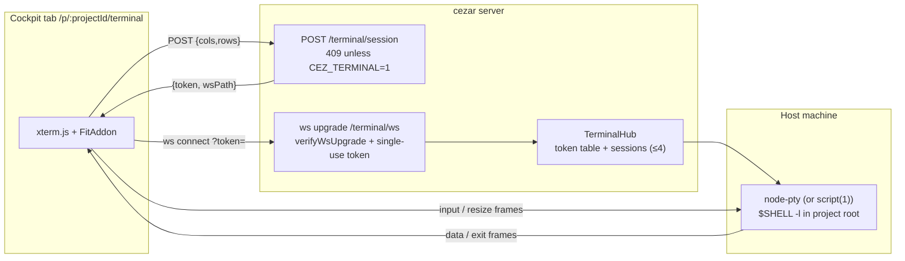

# Web Terminal Tab (Terminal epic)

## 📝 TLDR

The cockpit can watch agents work but cannot touch the machine they work on: anything beyond a
run — checking a hung process, reading a log the agent did not touch, restarting a service on
the Linux host cezar runs on — means leaving the browser for SSH. This epic adds a **Terminal
tab** (`/p/:projectId/terminal`): a real terminal emulator (xterm.js) over a WebSocket, backed by
a PTY spawned in the **project's own root** on the machine the cezar server runs on (macOS or
Linux).

The feature is **opt-in** (`CEZ_TERMINAL=1`, default off) — a remote shell on the host is the
strongest capability cezar has ever served, and AGENTS.md § Zero config routes exactly this kind
of exposure-widening feature behind a flag with the safe default. Off, the nav item is absent and
the endpoints answer `409`; nothing else changes. When on, a session exists only through a
single-use, 30-second token minted by a CSRF-guarded HTTP route and consumed by one WebSocket
upgrade, and the whole surface shuts off again under `CEZ_DRY_RUN=1`.

Implementation follows separately (`.ai/specs/2026-10-10-terminal-tab.md` is the design; the
bite-sized plan lives in `docs/superpowers/plans/2026-10-10-terminal-tab.md`).

## Resolved assumptions (autonomous defaults)

Written in autonomous mode. These were **not** answered by a human; each carries the
conservative default applied.

| # | Question | Applied default | Why conservative |
|---|---|---|---|
| Q1 | Default on or opt-in? | **Opt-in, `CEZ_TERMINAL=1`, exact value, boot-time.** | AGENTS.md § Zero config: "features that widen exposure or cost (network, other processes) are opt-in behind a `CEZ_*` flag, off by default". A PTY shell is the definition of both. Unlike dispatch (the owner-approved default-on exception) there is no engine brake that makes the inert default safe — the default IS the capability. |
| Q2 | Where does the terminal run? | **Project root of the scoped project**, `$SHELL -l` (fallback `/bin/zsh` on darwin, `/bin/bash` elsewhere), `TERM=xterm-256color`. | The tab is project-scoped like every cockpit view; a terminal that opens where the project lives answers the actual need ("get to the machine *and* the checkout"). The user can `cd` anywhere — this is a full shell, not a sandbox. |
| Q3 | PTY backend? | **A degradation ladder, tried in order at spawn time**: `node-pty` pinned to exactly `1.0.0` → `script(1)` (util-linux, **Linux only**) → the bare interactive `$SHELL -i` over pipes (everywhere). An honest `409` only when nothing can spawn. | Zero-config degradation law: a missing or BROKEN native module must shrink the feature, never fail the boot or the install — and the hub re-tries the next rung when a backend throws at spawn, so a bad node-pty yields a working (more degraded) terminal, not a dead tab. The findings that shaped this, discovered live: **(1)** `node-pty@1.1.0` fails EVERY spawn on macOS with `posix_spawnp failed.` — its npm tarball ships `prebuilds/darwin-arm64/spawn-helper` without the execute bit and nothing in the package ever chmods it (upstream: microsoft/node-pty#850); `1.0.0` has no prebuilds, so npm's implicit `node-gyp rebuild` compiles locally with correct modes — hence the exact pin, revisit only after verifying a real spawn. **(2)** BSD `script` (macOS) is unusable as a fallback: it runs `tcgetattr` on its own stdin and aborts on a pipe (`Operation not supported on socket`); util-linux on Linux is fine. **(3)** The bare-shell rung pays for the missing line discipline itself: `\r`→`\n` (what a TTY's ICRNL would do) and `\x03`→`SIGINT`; resize is a no-op and full-screen programs are off the table — that is what "degraded" means here. |
| Q4 | Transport? | **Dedicated WebSocket path** `/api/v1/p/:projectId/terminal/ws?token=…`, JSON frames, spawned on upgrade. | A PTY is a stateful byte stream with client→server input — not a publish/subscribe signal. Putting it on the topic bus would need base64 frames, an input side-channel and per-topic vigilance for exactly the data the bus must never carry. The "one socket per cockpit" rule governs the subscription bus; a terminal session is a per-session stream like a per-run SSE, so it owns its socket and dies with it. |
| Q5 | Who may open a session? | **Same-origin only, token-gated**: `POST /terminal/session` (behind the `/api/*` request-origin guard, a mutation, so CSRF-checked) returns a single-use 32-byte token valid 30 s; the upgrade consumes it and re-runs `verifyWsUpgrade`. | WebSocket has no CORS: without the token, any page the browser has open could open the socket and type into a shell on the host. The token is unreadable cross-origin (response reading is blocked) and the minting route rejects cross-site mutations, so a foreign local page — the one caller the WS guard cannot fully distinguish — has no path to a shell. |
| Q6 | Session limits? | **Max 4 live sessions per server process**; a session dies with its socket (no persistence, no re-attach, no output logged to disk). | The brakes are the point (see Q1). Nothing a terminal prints ever lands in `.ai/cezar/` — terminal output is the one thing this repo must never write down. |
| Q7 | Hosted / remote mode? | **No extra server-side gate beyond `CEZ_TERMINAL`.** The flag is explicit consent on whatever deployment it is set on; the same-origin + token guards apply identically. The remote cockpit renders the tab like any other when health reports the capability. | The cockpit already drives agent processes that run `Bash` over these same CSRF-guarded routes; in hosted mode the reverse proxy is the auth perimeter (repo-file-browser spec Q7). Adding a second, differently-spelled gate would create a mode where the flag silently does nothing. |
| Q8 | `CEZ_DRY_RUN=1`? | **Terminal off** (`capabilities.terminal` false, routes `409`). | Dry-run is the offline/mock contract the e2e suite boots with; an interactive shell is neither. |
| Q9 | Which emulator? | **`@xterm/xterm` + `@xterm/addon-fit`** in `packages/web`. | The standard browser terminal; VT sequences come from the PTY, so anything less (a `<pre>` + input line) cannot run vim/htop/less — the actual point. |

## Problem Statement

Every cezar run executes on a machine the cockpit deliberately keeps at arm's length: the UI
observes (steps, tool calls, tokens, diffs) and the only escape hatches are *local* handoffs —
"open in terminal/editor" (`capabilities.localHandoff`) that open apps on the **viewer's**
machine. When cezar itself runs on another box — the fork's documented deployment is a Mac
workspace and a Linux host — there is no way from the cockpit to that host at all: no process
list, no log outside a run's worktree, no way to poke at what an agent left behind.

Meanwhile the cockpit already renders everything needed to be a good terminal host: a
project-scoped shell route family, an SSE/WS event fabric, and a health capability system the
UI already trusts for gating (`followups`, `automations`, `dispatch`). What is missing is one
PTY bridge and one tab.

## Proposed Solution

Four pieces, each behind an existing seam:

1. **Contract** (`packages/contract/src/terminal.ts`): `POST /terminal/session` request/response
   schemas; one new required `capabilities.terminal` boolean (this server always sends it — the
   `tokenMetrics` lockstep precedent).
2. **Server** (`packages/cezar/src/server/terminal.ts`): a `TerminalHub` owning pending tokens
   and live sessions. `issue()` mints `{token, wsPath}` for a project context; `handleUpgrade()`
   is the one `upgrade`-event delegate the subscription bus hands non-bus paths to (ws.ts gains
   a delegate parameter; the bus's own path and destroy behavior are untouched). The PTY spawns
   on upgrade — a session exists only while its socket lives.
3. **Route family** (`server.ts`): one project-scoped route, `POST /terminal/session`, chained
   into the mirrored `v1` builder like its ~24 siblings, `409` when the flag is off.
4. **Cockpit**: a Terminal nav item (capability-gated, like Automations), a lazy
   `/terminal` route rendering xterm.js fitted to the main area, wired over a session-scoped
   WebSocket with input/resize/output frames.

**Takeaway:** one opt-in flag, one token-gated WS path, one new route family member — the rest
is assembly from parts the repo already trusts.

### Security model (the load-bearing paragraph)

A terminal is a shell on the host, served to a browser. The chain that must hold: **(1)** the
feature does not exist until `CEZ_TERMINAL=1` (exact value; `CEZ_DRY_RUN=1` forces it off) —
`capabilities.terminal` says so and the route refuses with `409` as defense in depth; **(2)**
minting a token is a mutating POST under the `/api/*` request-origin guard, so a cross-origin
page cannot get one (CSRF half) and cannot read one (cross-origin response reading is blocked);
**(3)** the upgrade re-runs `verifyWsUpgrade` (the same Host/Origin/Sec-Fetch discipline as the
bus) **and** requires a valid, unconsumed, unexpired token — a WebSocket has no CORS, so the
token is what closes the foreign-local-page hole the WS guard itself documents; **(4)** the
token is single-use and dies after 30 s, so neither a leaked URL nor a retry replay into a
session; **(5)** at most 4 sessions per process, each killed with its socket, and no terminal
byte is ever persisted. What this model deliberately does NOT claim: a terminal session is not
confined to the project directory (it is a shell — `cd ..` is one keystroke), and hosted-mode
deployments expose it to whoever the reverse proxy admits, exactly like every other mutating
route today. The flag is the consent switch for that trade.

## Alternatives considered

- **Multiplex through the `/api/v1/ws` topic bus.** Rejected in Q4: wrong shape (pub/sub vs
  interactive stream), and the bus's security invariant ("topics carry only data safe for any
  local page") would need a loophole for the one topic that is least safe.
- **HTTP request/response terminal (POST command → output).** Rejected: no TTY, no interactive
  programs, no escape sequences — a worse ssh, not a terminal.
- **Default-on like dispatch.** Rejected in Q1: dispatch's default-on rests on engine brakes
  (parallel cap, carved budgets); a shell has none. Opt-in with a documented flag is the
  conservative reading of the Zero-config law, and the same precedent (`CEZ_FOLLOWUPS=1`)
  shows the pattern: capability-gated nav item, `409` routes, honest UI copy.
- **Ship `node-pty` as a hard dependency.** Rejected: a native build failure would break
  `npm i -g` for everyone to serve a feature most users never enable. Optional with a `script`
  fallback keeps the install safe and the feature honest about what it could load.

## Impact

- **New surfaces:** `POST /api/v1/terminal/session` (+ `/api/v1/p/:projectId/` mirror,
  auto-inventoried), upgrade-only `/api/v1/p/:projectId/terminal/ws` (hand-entered in
  BACKWARD_COMPATIBILITY.md §2 like `/api/v1/ws`), `capabilities.terminal` in `/api/v1/health`,
  `CEZ_TERMINAL` in `.env.example` + `docs/reference.md`, a Terminal nav item + route.
- **Not touched:** the bus's topic protocol, existing routes, run lifecycle, on-disk state (the
  terminal writes nothing), the unversioned surface (still none).
